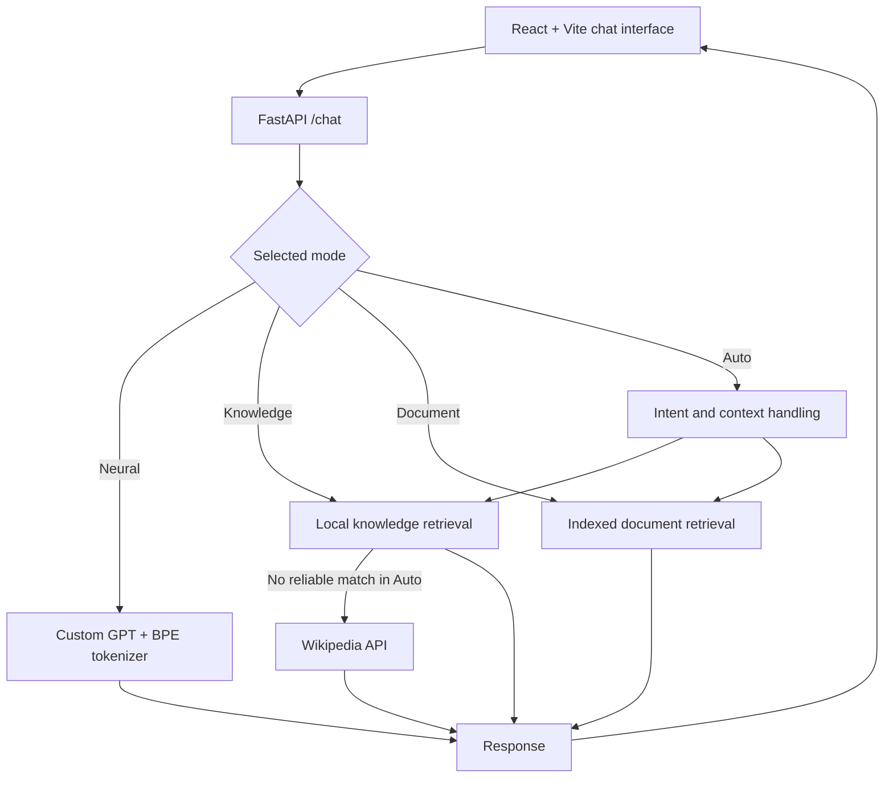

# MiniGPT — Custom Transformer Research Assistant

[](https://mini-gpt-ten.vercel.app/)
[](https://colab.research.google.com/drive/1T8YqimNICzSvJ2ADvMyUT-UCsiyROxME?usp=sharing)
[](https://www.python.org/)
[](https://pytorch.org/)
[](https://fastapi.tiangolo.com/)
[](https://react.dev/)

**Live demo:** [https://mini-gpt-ten.vercel.app/](https://mini-gpt-ten.vercel.app/)  
**Training notebook:** [Open in Google Colab](https://colab.research.google.com/drive/1T8YqimNICzSvJ2ADvMyUT-UCsiyROxME?usp=sharing)  
**Source code:** [GitHub — Mini-GPT](https://github.com/srA12-png/Mini-GPT)

## Overview

MiniGPT is an end-to-end Generative AI learning project that implements a small GPT-style language model from scratch in PyTorch and integrates it into a full-stack research assistant.

Rather than relying on a paid generative AI API, the project combines a custom-trained Transformer, a byte-pair encoding (BPE) tokenizer, local knowledge retrieval, indexed document search, and a Wikipedia fallback. The application exposes these capabilities through a FastAPI backend and an interactive React interface.

The model is educational, not a replacement for a production-scale large language model. The hosted demo is designed to support lightweight retrieval on resource-constrained hosting; full neural inference and embedding-based search are available in a local environment with the necessary ML dependencies.

## Key Features

- **Custom GPT:** Implemented causal self-attention, multi-head attention, feed-forward layers, residual connections, layer normalization, and autoregressive token generation.
- **Custom tokenizer:** Trained a BPE tokenizer and used conversation-specific special tokens.
- **Model training:** Pretrained a small GPT-style network and performed basic instruction fine-tuning.
- **Model serialization:** Saved the trained weights, vocabulary, tokenizer, and model configuration in a reusable checkpoint.
- **Knowledge retrieval:** Searches a curated question-answer knowledge base, using semantic embeddings when available and lightweight matching otherwise.
- **Document retrieval:** Finds relevant passages in indexed document chunks and returns source references.
- **Online knowledge:** Uses the Wikipedia MediaWiki API as a fallback for unfamiliar questions in Auto mode.
- **Intent recognition:** Handles common greetings, farewells, gratitude, identity requests, and document-related queries.
- **Conversational context:** Supports selected follow-up patterns using the previous topic and mode.
- **Interactive interface:** Conversation history, new chats, mode selection, source links, copy controls, and model status.
- **API:** Request validation, structured responses, and a health endpoint.

## Architecture



### Model configuration

| Property | Value |
|---|---:|
| Architecture | Decoder-only GPT-style Transformer |
| Trained parameters | Approximately 1.06 million |
| Embedding dimension | 128 |
| Transformer blocks | 4 |
| Attention heads | 4 |
| Context length | 64 tokens |
| BPE vocabulary size | Approximately 1,024 |
| Framework | PyTorch |
| Training environment | Google Colab |
| Saved checkpoint | `minigpt_chat.pth` |

The parameter count refers to the locally trained checkpoint, not to a measurement of the lightweight hosted runtime.

### Transformer internals

1. Convert input text into BPE token IDs.
2. Combine token and positional embeddings.
3. Apply masked multi-head self-attention so each position attends only to preceding positions.
4. Apply feed-forward transformations, residual connections, and layer normalization.
5. Project hidden states onto the vocabulary.
6. Predict subsequent tokens autoregressively.

### Training journey

[View the original Google Colab training notebook](https://colab.research.google.com/drive/1T8YqimNICzSvJ2ADvMyUT-UCsiyROxME?usp=sharing) for the project’s learning and experimentation workflow.

The project started with character-level language modeling and progressively introduced a Transformer, a BPE tokenizer, story-text training, and a small instructional question-answer dataset. Its checkpoint contains model weights and configuration so training and local inference can be decoupled from the web application.

## Response Modes

| Mode | Behavior |
|---|---|
| **Auto** | Routes simple conversational intents and relevant document queries; uses knowledge retrieval and Wikipedia fallback. |
| **Knowledge** | Searches the curated knowledge base. |
| **Document** | Retrieves relevant passages from the indexed documents. |
| **Neural (Experimental)** | Generates tokens using the custom-trained GPT checkpoint when PyTorch and tokenizers are available. |

The initial knowledge assets include 176 knowledge entries and 80 document chunks. The retrieval-based answers are not generated by the neural network; they are returned from matched sources.

## Technology Stack

| Layer | Technologies |
|---|---|
| Language model | Python, PyTorch |
| Tokenization | Hugging Face Tokenizers, BPE |
| Retrieval | Sentence Transformers (optional), keyword-based fallback |
| External knowledge | Wikipedia / MediaWiki API |
| Backend | FastAPI, Uvicorn, Pydantic |
| Frontend | React, Vite, JavaScript, CSS |
| Storage | JSON knowledge and document assets; model checkpoint |
| Deployment | Vercel frontend, Python backend deployment configuration for Render |
| Development | Google Colab, VS Code, Git, GitHub |

## Repository Structure

```text
Mini-GPT/
├── backend/
│   ├── main.py                 # FastAPI endpoints and routing
│   ├── engine.py               # GPT architecture and inference
│   ├── retrieval.py            # Knowledge and document retrieval
│   ├── intent.py               # Basic intent recognition
│   ├── web_search.py            # Wikipedia fallback
│   ├── requirements.txt        # Lightweight deployment dependencies
│   └── assets/
│       ├── minigpt_chat.pth
│       ├── minigpt_knowledge.json
│       └── minigpt_documents.json
├── frontend/
│   ├── src/
│   │   ├── api/minigpt.js       # API client
│   │   ├── components/         # Chat and sidebar components
│   │   ├── utils/storage.js     # Browser-side history storage
│   │   └── App.jsx
│   ├── package.json
│   └── vite.config.js
├── assets/                     # Original exported model assets
├── render.yaml
├── vercel.json
└── README.md
```

## Run Locally

### Prerequisites

- Python 3.11 recommended
- Node.js LTS compatible with the frontend's Vite version
- npm and Git

### 1. Clone the repository

```bash
git clone https://github.com/srA12-png/Mini-GPT.git
cd Mini-GPT
```

### 2. Start the backend

On Windows (PowerShell):

```powershell
python -m venv .venv
.\.venv\Scripts\python.exe -m pip install -r backend/requirements.txt
.\.venv\Scripts\python.exe -m pip install torch --index-url https://download.pytorch.org/whl/cpu
.\.venv\Scripts\python.exe -m pip install tokenizers sentence-transformers
.\.venv\Scripts\python.exe -m uvicorn main:app --app-dir backend --host 127.0.0.1 --port 8000
```

For a lightweight backend, skip the two ML installation commands. Neural generation and semantic embeddings will then be unavailable.

Backend: http://127.0.0.1:8000  
Interactive API documentation: http://127.0.0.1:8000/docs

### 3. Start the frontend

Open a second terminal in the repository root:

```bash
cd frontend
npm install
npm run dev
```

Open http://localhost:5173.

## API Endpoints

| Method | Endpoint | Purpose |
|---|---|---|
| GET | `/` | API status message |
| GET | `/health` | Runtime model and knowledge metadata |
| POST | `/chat` | Submit a question |
| GET | `/api/health` | Alternative health route |
| POST | `/api/chat` | Alternative chat route |

Example chat request:

```json
{
  "message": "What is quantum computing?",
  "mode": "auto",
  "context": null
}
```

## Deployment

**Public demo:** https://mini-gpt-ten.vercel.app/

The frontend is configured for Vercel. The FastAPI backend can run on Render with the following settings:

- Root directory: `backend`
- Build: `pip install -r requirements.txt`
- Start: `uvicorn main:app --host 0.0.0.0 --port $PORT`
- Python version: `3.11.9`
- Health check: `/health`

For separate frontend and backend deployments, set `VITE_API_URL` to the actual HTTPS backend URL, allow the deployed frontend origin in FastAPI's CORS configuration, and redeploy the frontend.

The lightweight requirements do not install PyTorch, tokenizers, or Sentence Transformers. Check the live health endpoint's `model_loaded` field before claiming neural inference is available online. Free hosting can also have cold starts and limited memory.

## Limitations

- A 1.06M-parameter model has limited reasoning, factual knowledge, and instruction-following ability.
- Neural mode is experimental and can produce inaccurate or irrelevant text.
- Retrieved Wikipedia and document excerpts are not guaranteed to answer every question precisely.
- Context handling is limited to supported follow-up patterns, rather than unrestricted long-term memory.
- The hosted lightweight configuration may disable neural generation and semantic embeddings.
- Formal accuracy, latency, and quality benchmarks have not been established.

## Learning Outcomes

This project demonstrates practical experience in:

- Transformer architecture and attention mechanisms
- Tokenization, language modeling, and fine-tuning
- Checkpoint management and model inference
- Information retrieval and external API integration
- Full-stack application development
- Cloud deployment and troubleshooting

## Credits and References

- [Andrej Karpathy — Let's build GPT: from scratch, in code, spelled out](https://www.youtube.com/watch?v=kCc8FmEb1nY) — foundational tutorial.
- [Karpathy's accompanying lecture repository](https://github.com/karpathy/ng-video-lecture) — architecture reference.
- [Attention Is All You Need](https://arxiv.org/abs/1706.03762) — Transformer research.
- [Language Models are Few-Shot Learners](https://arxiv.org/abs/2005.14165) — GPT research.
- [TinyStories](https://huggingface.co/datasets/roneneldan/TinyStories) — story dataset used during experimentation.
- [all-MiniLM-L6-v2](https://huggingface.co/sentence-transformers/all-MiniLM-L6-v2) — optional pretrained retrieval embeddings.
- [Wikipedia](https://en.wikipedia.org/) — online knowledge source; article attribution is displayed in responses.

## Author

**Siva Reddy**  
[GitHub @srA12-png](https://github.com/srA12-png)

Built as an educational Generative AI project exploring how a GPT model works, from training to a full-stack AI assistant.
